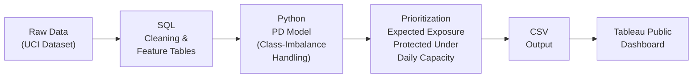

# Credit Card Early Warning & Limited Review Capacity Optimization

A decision-support tool that helps bank early collections teams prioritize which customers to contact first, maximizing recovered exposure within limited staff capacity.

**Graduation Project** — Management Information Systems (English), Istanbul University
**Course:** *From Idea to MVP* (Sept 2026 – Mar 2027)


### At a Glance

- **Problem:** Early collections teams receive more warning signals than they can act on. Existing risk scores rank by probability of default, not by the value of intervening — so effort is wasted on customers who would pay anyway or cannot be recovered.
- **Approach:** A transparent dashboard that ranks accounts by expected exposure protected (PD × exposure), routes low-risk cases to automated channels, and flags accounts for proactive limit freezes.
- **Status:** Field validation and value proposition are complete. Solution design starts December 2026. No code, model, or dashboard exists yet.

---

## The Problem

Credit monitoring and early collections teams in banks receive more early-warning signals every day than they can review or call. Existing risk scores rank customers by **probability of default (PD)**, not by the **value of intervening**.

As a result, limited staff time goes to customers who would **pay anyway** (self-cure) or **cannot be recovered regardless**, while high-exposure accounts slip into later delinquency buckets (1–30 → 31–60 → 61–90 → 90+ days).

A delayed **limit freeze** lets customers draw the remaining credit limit as cash, increasing **exposure at default (EAD)**. This drives up credit losses, IFRS 9 provisions, and legal costs.

---

## Field Validation

> All findings are anonymized. No individuals, banks, or companies are identified.

**7 interviews** were conducted with professionals across banking, credit risk, fintech, internal audit, and insurance recovery.

### Key Findings

1. **The real user is the Credit Monitoring / Early Collections team**, not the risk-modeling department.
2. **Static PD scores are insufficient** — they cannot distinguish customers who will self-cure from those who will not pay regardless, so effort is wasted on both groups.
3. **Delayed limit freezes increase exposure** — customers can draw remaining credit as cash advances before the freeze takes effect, raising EAD.
4. **Capacity bottlenecks are cyclical** — they recur at month-end, salary periods, and after statement cut-off dates.
5. **The same capacity problem exists in insurance recovery teams**, where it is currently handled on an ad-hoc basis.

---

## Planned Solution

> Everything described below is planned, not built.
> Solution design starts in December 2026.

### Features

| Feature | Description |
|---|---|
| Daily contact list | Capped at team capacity (e.g., 200 files/day), ranked by expected exposure protected (PD × exposure), not by PD alone. |
| Channel routing | Likely self-cure, low-balance accounts → automated SMS/IVR; staff calls reserved for high-exposure accounts. |
| Limit-freeze alerts | Flags accounts with high unused credit limit and rising utilization for proactive limit action. |
| What-if capacity simulator | Lets team leads test scenarios: "What if we add 2 FTEs?" or "What if call volume doubles at month-end?" |

### Pipeline



### How It Differs from Traditional Approaches

| Dimension | Traditional Approach | Planned Approach |
|---|---|---|
| Ranking basis | Probability of default (PD) alone | Expected exposure protected (PD × exposure) |
| Who gets called | Highest-PD customers, regardless of recoverability | Accounts where intervention changes the outcome most |
| Channel | Manual calls for all flagged accounts | Automated SMS/IVR for self-cure; staff calls for high-exposure |
| Limit action | Reactive freeze after delinquency | Proactive alert when unused limit is high and utilization rises |
| Transparency | Black-box scoring | Explainable ranking with clear capacity constraints |

---

## Data

| Dataset | Description |
|---|---|
| **Primary:** [UCI — Default of Credit Card Clients](https://archive.ics.uci.edu/dataset/350/default+of+credit+card+clients) | 30,000 customers (Taiwan). Includes payment history, bill amounts, credit limit, and demographic attributes. |
| **Alternative under evaluation:** Home Credit Default Risk (Kaggle) | Being considered because the UCI dataset lacks an income variable. |

**Fairness note:** Sensitive attributes (SEX, MARRIAGE, EDUCATION) will be excluded from prioritization decisions.

**Privacy note:** Only publicly available datasets are used. No real bank customer data is involved in this project.

---

## Tech Stack (Planned)

| Tool | Used for |
|---|---|
| SQL (Oracle) | Data cleaning, feature engineering, aggregation |
| Python (pandas, scikit-learn) | PD modeling, class-imbalance handling, prioritization logic |
| Tableau Public | Interactive dashboard and visualizations |
| Git / GitHub | Version control and project documentation |

---

## Planned Repository Structure

> This structure is planned and will be created as development begins.

```
credit-card-early-warning/
├── data/           # Raw and processed datasets
├── sql/            # Cleaning, feature engineering and aggregation queries
├── notebooks/      # Exploratory analysis and model development
├── outputs/        # Model outputs and prioritized contact lists (CSV)
├── dashboard/      # Tableau workbook and dashboard assets
└── docs/           # Project documentation and reports
```

---

## Roadmap

- [x] Idea, Problem & Customer — Oct 2026
- [x] Field Validation (7 interviews) — Nov 2026
- [x] Value Proposition & Business Model Canvas — Nov 2026
- [ ] Solution Concept — Dec 2026
- [ ] MVP Design — Dec 2026
- [ ] MVP Build: SQL + Python + Tableau — Jan 2027
- [ ] User Testing with practitioners — Feb 2027
- [ ] Final Pitch — Mar 2027

---

## Author & Acknowledgements

**Battal Buğra Karataş** — [LinkedIn](https://www.linkedin.com/in/battalbugrakaratas/)

**Advisor:** Assoc. Prof. Dr. Gökhan Övenç

Thanks to the anonymous banking, credit risk, fintech, audit, and insurance recovery professionals who generously shared their time and insights during the field validation interviews.

---

## Disclaimer

This is an academic graduation project using only publicly available datasets. It is not affiliated with or endorsed by any bank, financial institution, or company. All field validation interviews are fully anonymized.

---

## License

TBD

---

<sub>Istanbul University · Management Information Systems · 2026–2027</sub>
